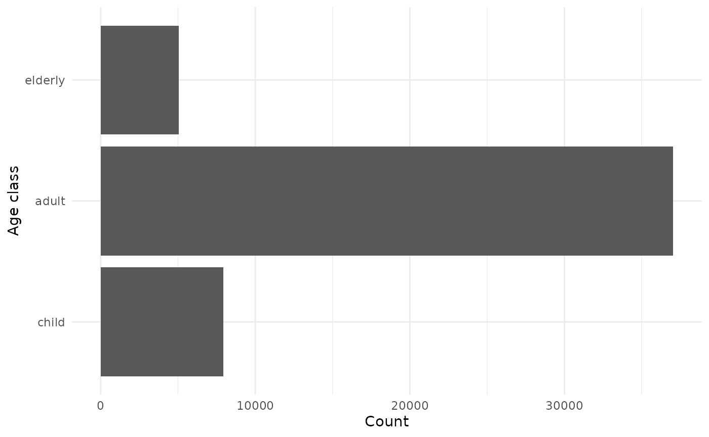
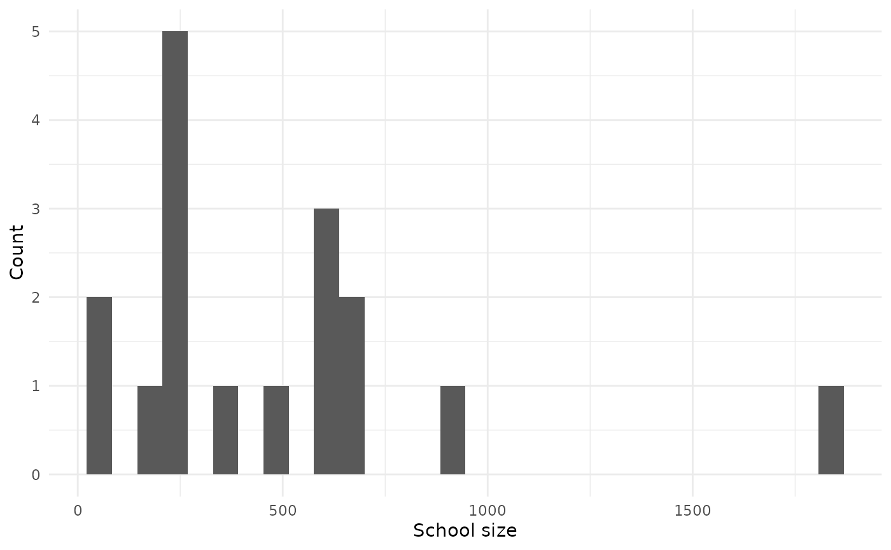
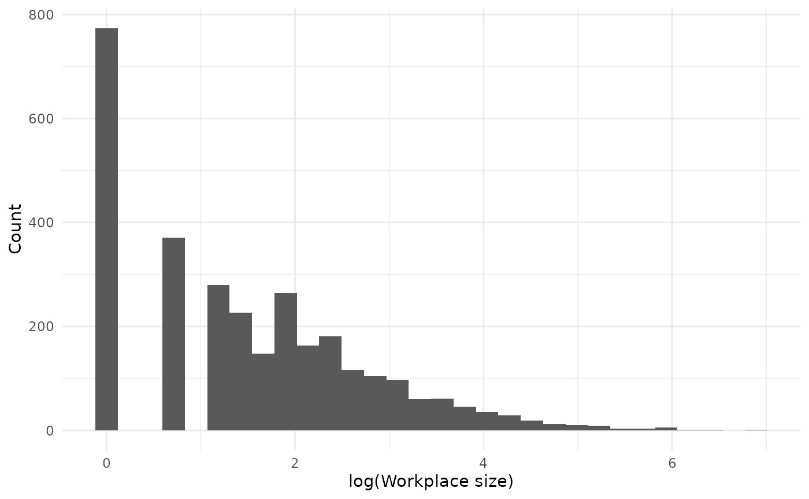
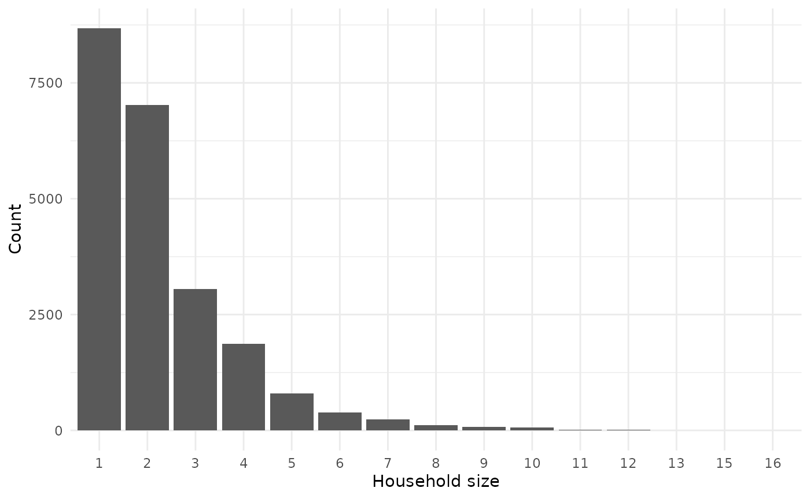
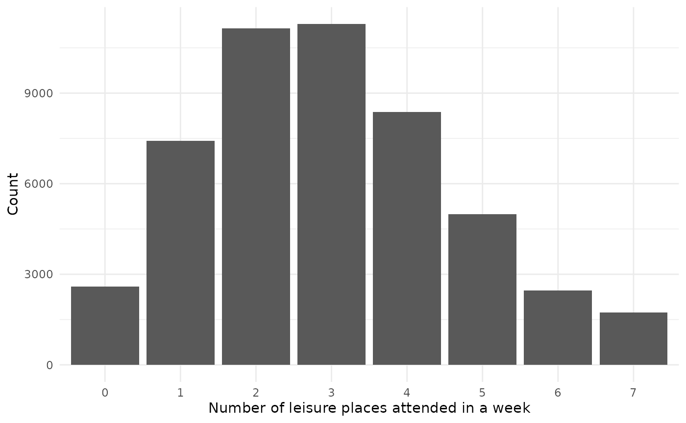
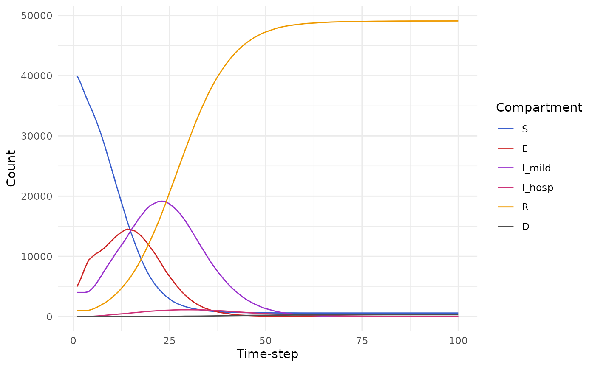

# Get started

This vignette is not up to date with latest changes to the model!

## Introduction

[`helios`](https://mrc-ide.github.io/helios/) is an R package which
allows users to simulate the impact of [far
UVC](https://www.nature.com/articles/s41598-018-21058-w) interventions
in curtailing the spread of infectious disease outbreaks.

This vignette serves to demonstrate basic use of the package. We start
by loading the package, as well as other packages used in the vignette:

``` r

library(helios)
library(individual)
library(ggplot2)
library(dplyr, warn.conflicts = FALSE)
library(purrr)
library(tictoc)
theme_set(theme_minimal())
```

## Parameters

First, we define some constant parameters to be used in the model. In
this vignette we use the default options, aside from the
`human_population` variable. To facilitate reproducibility, we also set
the seed for random number generation:

``` r

parameters_list <- get_parameters(list(human_population = 50000, 
                                       number_initial_S = 40000,
                                       number_initial_E = 5000,
                                       number_initial_I = 4000,
                                       number_initial_R = 1000,
                                       simulation_time = 50,
                                       seed = 1))
```

Every setting also needs an air changes per hour (ACH) value. Here we
use a uniform baseline of 4 ACH in each setting:

``` r

for (setting in c("household", "workplace", "school", "leisure")) {
  parameters_list <- set_default_ach(parameters_list, setting = setting, ach = 4)
}
```

The names of all parameters are as follows:

``` r

names(parameters_list)
#>   [1] "human_population"                      
#>   [2] "initial_proportion_child"              
#>   [3] "initial_proportion_adult"              
#>   [4] "initial_proportion_elderly"            
#>   [5] "number_initial_S"                      
#>   [6] "number_initial_E"                      
#>   [7] "number_initial_I"                      
#>   [8] "number_initial_R"                      
#>   [9] "seed"                                  
#>  [10] "mean_household_size"                   
#>  [11] "workplace_prop_max"                    
#>  [12] "workplace_a"                           
#>  [13] "workplace_c"                           
#>  [14] "school_prop_max"                       
#>  [15] "school_meanlog"                        
#>  [16] "school_sdlog"                          
#>  [17] "school_student_staff_ratio"            
#>  [18] "leisure_prob_visit"                    
#>  [19] "leisure_mean_number_settings"          
#>  [20] "leisure_mean_size"                     
#>  [21] "leisure_overdispersion_size"           
#>  [22] "leisure_prop_max"                      
#>  [23] "duration_exposed"                      
#>  [24] "duration_infectious"                   
#>  [25] "beta_household"                        
#>  [26] "beta_workplace"                        
#>  [27] "beta_school"                           
#>  [28] "beta_leisure"                          
#>  [29] "beta_community"                        
#>  [30] "time_varying_transmission_on"          
#>  [31] "dt"                                    
#>  [32] "simulation_time"                       
#>  [33] "render_diagnostics"                    
#>  [34] "household_distribution_country"        
#>  [35] "school_distribution_country"           
#>  [36] "workplace_distribution_country"        
#>  [37] "endemic_or_epidemic"                   
#>  [38] "duration_immune"                       
#>  [39] "prob_inf_external"                     
#>  [40] "setting_specific_ach_workplace"        
#>  [41] "setting_specific_ach_workplace_mean"   
#>  [42] "setting_specific_ach_workplace_sd"     
#>  [43] "setting_specific_ach_school"           
#>  [44] "setting_specific_ach_school_mean"      
#>  [45] "setting_specific_ach_school_sd"        
#>  [46] "setting_specific_ach_leisure"          
#>  [47] "setting_specific_ach_leisure_mean"     
#>  [48] "setting_specific_ach_leisure_sd"       
#>  [49] "setting_specific_ach_household"        
#>  [50] "setting_specific_ach_household_mean"   
#>  [51] "setting_specific_ach_household_sd"     
#>  [52] "default_ach_workplace"                 
#>  [53] "default_ach_school"                    
#>  [54] "default_ach_leisure"                   
#>  [55] "default_ach_household"                 
#>  [56] "volume_per_person_workplace"           
#>  [57] "volume_per_person_school"              
#>  [58] "volume_per_person_leisure"             
#>  [59] "volume_per_person_household"           
#>  [60] "wells_riley_emission_rate"             
#>  [61] "wells_riley_decay_rate"                
#>  [62] "wells_riley_infection_prob_per_ffu"    
#>  [63] "wells_riley_respiratory_rate_factor"   
#>  [64] "wells_riley_time_in_room"              
#>  [65] "intervention_joint_active"             
#>  [66] "intervention_joint_list"               
#>  [67] "intervention_joint_coverage"           
#>  [68] "intervention_joint_coverage_target"    
#>  [69] "intervention_joint_coverage_type"      
#>  [70] "intervention_joint_timestep"           
#>  [71] "intervention_workplace_active"         
#>  [72] "intervention_workplace_list"           
#>  [73] "intervention_workplace_coverage"       
#>  [74] "intervention_workplace_coverage_target"
#>  [75] "intervention_workplace_coverage_type"  
#>  [76] "intervention_workplace_timestep"       
#>  [77] "intervention_workplace_covered"        
#>  [78] "intervention_school_active"            
#>  [79] "intervention_school_list"              
#>  [80] "intervention_school_coverage"          
#>  [81] "intervention_school_coverage_target"   
#>  [82] "intervention_school_coverage_type"     
#>  [83] "intervention_school_timestep"          
#>  [84] "intervention_school_covered"           
#>  [85] "intervention_leisure_active"           
#>  [86] "intervention_leisure_list"             
#>  [87] "intervention_leisure_coverage"         
#>  [88] "intervention_leisure_coverage_target"  
#>  [89] "intervention_leisure_coverage_type"    
#>  [90] "intervention_leisure_timestep"         
#>  [91] "intervention_leisure_covered"          
#>  [92] "intervention_household_active"         
#>  [93] "intervention_household_list"           
#>  [94] "intervention_household_coverage"       
#>  [95] "intervention_household_coverage_target"
#>  [96] "intervention_household_coverage_type"  
#>  [97] "intervention_household_timestep"       
#>  [98] "intervention_household_covered"        
#>  [99] "size_per_individual_workplace"         
#> [100] "size_per_individual_school"            
#> [101] "size_per_individual_leisure"           
#> [102] "size_per_individual_household"         
#> [103] "prob_hosp_child"                       
#> [104] "prob_hosp_adult"                       
#> [105] "prob_hosp_elderly"                     
#> [106] "prob_death_hosp_child"                 
#> [107] "prob_death_hosp_adult"                 
#> [108] "prob_death_hosp_elderly"               
#> [109] "duration_hospitalized"
```

## Variables

Next, we define the model variables:

``` r

variables_list <- create_variables(parameters_list)
variables_list <- variables_list$variables_list
names(variables_list)
#> [1] "disease_state"    "age_class"        "workplace"        "school"          
#> [5] "household"        "leisure"          "specific_leisure"
```

Aside from `leisure`, each entry of `variables_list` is of the
[`CategoricalVariable`](https://mrc-ide.github.io/individual/reference/CategoricalVariable.html)
class:

``` r

map(variables_list, class)
#> $disease_state
#> [1] "CategoricalVariable" "R6"                 
#> 
#> $age_class
#> [1] "CategoricalVariable" "R6"                 
#> 
#> $workplace
#> [1] "CategoricalVariable" "R6"                 
#> 
#> $school
#> [1] "CategoricalVariable" "R6"                 
#> 
#> $household
#> [1] "CategoricalVariable" "R6"                 
#> 
#> $leisure
#> [1] "RaggedInteger" "R6"           
#> 
#> $specific_leisure
#> [1] "CategoricalVariable" "R6"
```

The `leisure` variable is a
[`RagggedInteger`](https://mrc-ide.github.io/individual/reference/RaggedInteger.html)
allowing its elements to have different lengths.

Some variables change over time (`disease_state`, `leisure`,
`specific_leisure`), while other remain fixed (`age_class`, `workplace`,
`school`, `household`).

### Disease states

The outbreak is implemented as individual-level SEIR [compartmental
model](https://en.wikipedia.org/wiki/Compartmental_models_in_epidemiology).

``` r

(disease_states <- variables_list$disease_state$get_categories())
#> [1] "S"      "E"      "I_mild" "I_hosp" "R"      "D"
```

The number of individuals initially exposed is controlled by
`parameters_list$number_initial_E` and
`parameters_list$number_initial_I`

``` r

parameters_list$number_initial_E
#> [1] 5000
parameters_list$number_initial_I
#> [1] 4000
```

Initially, all other individuals are placed into the susceptible disease
state:

``` r

disease_state_counts <- purrr::map_vec(disease_states, function(x) variables_list$disease_state$get_size_of(values = x))

data.frame("State" = disease_states, "Count" = disease_state_counts) |>
  gt::gt()
```

| State  | Count |
|--------|-------|
| S      | 40000 |
| E      | 5000  |
| I_mild | 4000  |
| I_hosp | 0     |
| R      | 1000  |
| D      | 0     |

### Age classes

There are three age classes: children, adults, and the elderly. The age
of each individual remains fixed throughout the simulation.

``` r

parameters_list[c("initial_proportion_child", "initial_proportion_adult", "initial_proportion_elderly")]
#> $initial_proportion_child
#> [1] 0.2
#> 
#> $initial_proportion_adult
#> [1] 0.6
#> 
#> $initial_proportion_elderly
#> [1] 0.2

age_classes <- variables_list$age_class$get_categories()
age_class_counts <- purrr::map_vec(age_classes, function(x) variables_list$age_class$get_size_of(values = x))

data.frame(age_classes, age_class_counts) |>
  mutate(age_classes = forcats::fct_relevel(age_classes, "child", "adult", "elderly")) |>
  ggplot(aes(x = age_classes, y = age_class_counts)) +
  geom_col() +
  labs(x = "Age class", y = "Count") +
  coord_flip()
```



### Schools

Each child attends a fixed school. Additionally, a small number of
adults attend schools as staff:

``` r

schools <- variables_list$school$get_categories()
schools <- schools[schools != "0"]
school_sizes <- purrr::map_vec(schools, function(x) variables_list$school$get_size_of(values = x))

data.frame(school_sizes) |>
  ggplot(aes(x = school_sizes)) +
  geom_histogram() +
  labs(x = "School size", y = "Count")
#> `stat_bin()` using `bins = 30`. Pick better value `binwidth`.
```



### Workplaces

Each adult (aside from those who are school staff) attends a fixed
workplace:

``` r

workplaces <- variables_list$workplace$get_categories()
workplaces <- workplaces[workplaces != "0"]
workplace_sizes <- purrr::map_vec(workplaces, function(x) variables_list$workplace$get_size_of(values = x))

data.frame(workplace_sizes) |>
  ggplot(aes(x = log(workplace_sizes))) +
  geom_histogram() +
  labs(x = "log(Workplace size)", y = "Count")
#> `stat_bin()` using `bins = 30`. Pick better value `binwidth`.
```



### Households

Children, adults and elderly people are grouped into fixed households:

``` r

households <- variables_list$household$get_categories()
household_sizes <- purrr::map_vec(households, function(x) variables_list$household$get_size_of(values = x))

table(household_sizes) |>
  data.frame() |>
  ggplot(aes(x = household_sizes, y = Freq)) +
  geom_col() +
  labs(x = "Household size", y = "Count")
```



The age distribution in households is as follows:

``` r

household_df <- purrr::map_df(households, function(x) {
  indices <- variables_list$household$get_index_of(values = x)$to_vector()
  if(length(indices > 0)) data.frame("individual" = indices, "household" = as.numeric(x))
})

age_classes <- variables_list$age_class$get_categories()
age_df <- purrr::map_df(age_classes, function(x) {
  indices <- variables_list$age_class$get_index_of(values = x)$to_vector()
  if(length(indices > 0)) data.frame("individual" = indices, "age_class" = x)
})

household_df |>
  left_join(age_df, by = "individual") |>
  group_by(household) |>
  summarise(
    child = sum(age_class == "child"),
    adult = sum(age_class == "adult"),
    elderly = sum(age_class == "elderly")
  ) |>
  group_by(child, adult, elderly) |>
  summarise(
    count = n()
  ) |>
  ungroup() |>
  arrange(desc(count)) |>
  head() |>
  gt::gt()
#> `summarise()` has regrouped the output.
#> ℹ Summaries were computed grouped by child, adult, and elderly.
#> ℹ Output is grouped by child and adult.
#> ℹ Use `summarise(.groups = "drop_last")` to silence this message.
#> ℹ Use `summarise(.by = c(child, adult, elderly))` for per-operation grouping
#>   (`?dplyr::dplyr_by`) instead.
```

| child | adult | elderly | count |
|-------|-------|---------|-------|
| 0     | 1     | 0       | 7078  |
| 0     | 2     | 0       | 5250  |
| 0     | 0     | 1       | 1585  |
| 1     | 2     | 0       | 1337  |
| 0     | 3     | 0       | 1135  |
| 2     | 2     | 0       | 936   |

### Leisure

Each week, individuals attend leisure venues:

``` r

leisure_places <- variables_list$leisure$get_values()
number_leisure_places <- sapply(leisure_places, function(x) sum(x > 0))

table(number_leisure_places) |>
  data.frame() |>
  ggplot(aes(x = number_leisure_places, y = Freq)) +
  geom_col() +
  labs(x = "Number of leisure places attended in a week", y = "Count")
```



## Events

Events govern the transition of individuals between disease states:

``` r

events_list <- create_events(variables_list = variables_list, parameters_list = parameters_list)
names(events_list)
#> [1] "EI_mild_event"  "EIhosp_event"   "I_mild_R_event" "I_hosp_R_event"
#> [5] "I_hosp_D_event"
```

Each event is in the
[`TargetedEvent`](https://mrc-ide.github.io/individual/reference/TargetedEvent.html)
class:

``` r

lapply(events_list, class)
#> $EI_mild_event
#> [1] "TargetedEvent" "EventBase"     "R6"           
#> 
#> $EIhosp_event
#> [1] "TargetedEvent" "EventBase"     "R6"           
#> 
#> $I_mild_R_event
#> [1] "TargetedEvent" "EventBase"     "R6"           
#> 
#> $I_hosp_R_event
#> [1] "TargetedEvent" "EventBase"     "R6"           
#> 
#> $I_hosp_D_event
#> [1] "TargetedEvent" "EventBase"     "R6"
```

## Render

We use a fixed number of time-steps to simulate over:

``` r

timesteps <- round(parameters_list$simulation_time / parameters_list$dt)
```

The object `renderer` is of class
[`Render`](https://mrc-ide.github.io/individual/reference/Render.html),
and stores output from the model at each timestep:

``` r

renderer <- individual::Render$new(timesteps)
class(renderer)
#> [1] "Render" "R6"
```

## Processes

Processes enable queing of events:

``` r

variables_list <- create_variables(parameters_list)
parameters_list <- variables_list$parameters_list 
variables_list <- variables_list$variables_list
events_list <- create_events(variables_list = variables_list, parameters_list = parameters_list)
timesteps <- round(parameters_list$simulation_time/parameters_list$dt)
renderer <- individual::Render$new(timesteps)

processes_list <- create_processes(
  variables_list = variables_list,
  events_list = events_list,
  parameters_list = parameters_list,
  renderer = renderer
)

names(processes_list)
#> [1] "SE_process"          "EI_process"          "I_mild_R_process"   
#> [4] "I_hosp_exit_process" "renderer"
```

## Simulate

See
[`individual::simulation_loop`](https://mrc-ide.github.io/individual/reference/simulation_loop.html):

``` r

individual::simulation_loop(
  variables = variables_list,
  events = unlist(events_list),
  processes = processes_list,
  timesteps = timesteps,
)
```

The output of the simulation is contained within `renderer`, and can be
accessed using the `to_dataframe()` method:

``` r

states <- renderer$to_dataframe()

states |>
  tidyr::pivot_longer(cols = ends_with("count"), names_to = "compartment", values_to = "value", names_pattern = "(.*)_count") |>
  mutate(
    compartment = forcats::fct_relevel(compartment, "S", "E", "I_mild", "I_hosp", "R", "D")
  ) |>
  ggplot(aes(x = timestep, y = value, col = compartment)) +
  geom_line() +
  scale_color_manual(values = c("royalblue3", "firebrick3", "darkorchid3", "violetred3", "orange2", "grey30")) +
  labs(x = "Time-step", y = "Count", col = "Compartment")
```


